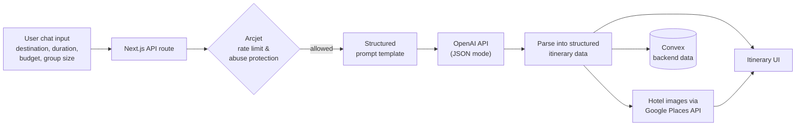
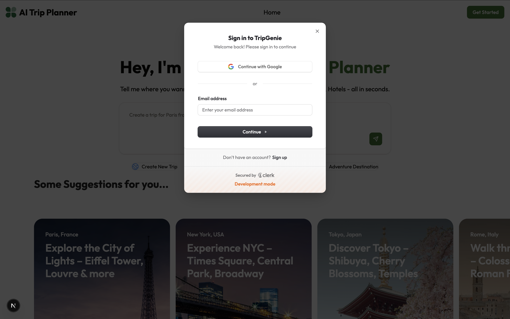
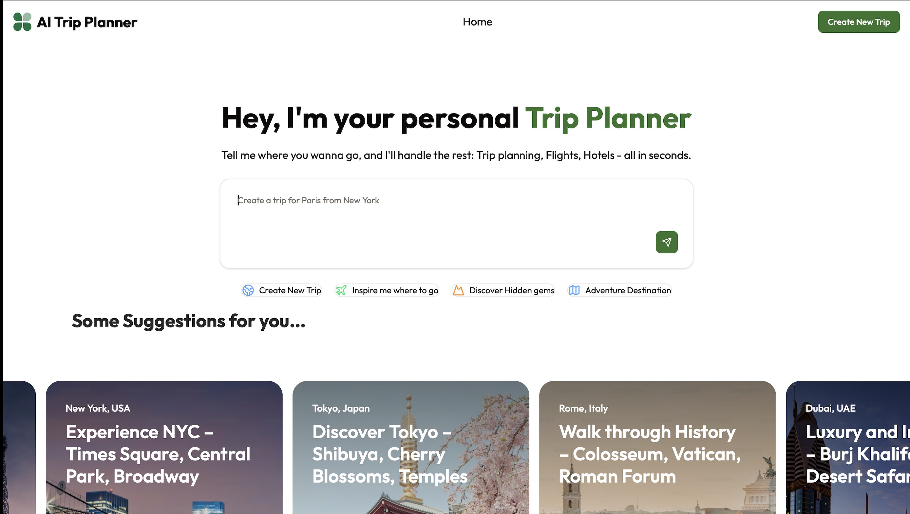
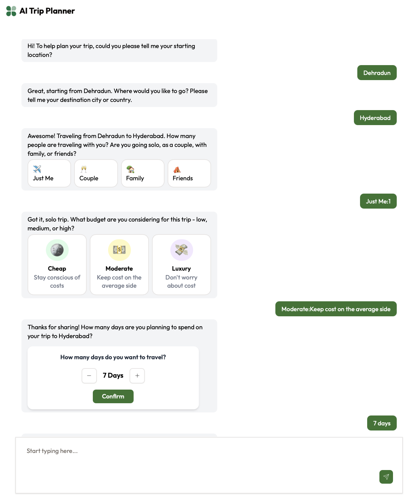
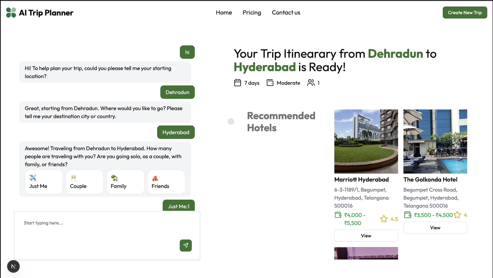
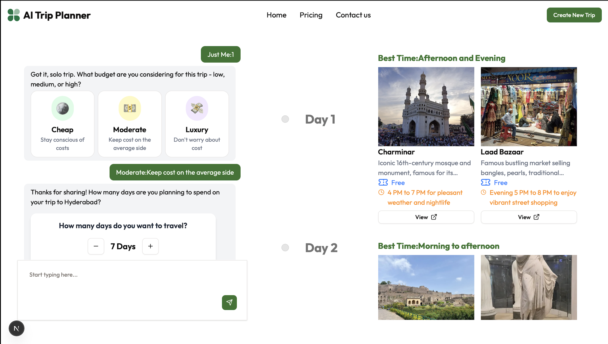
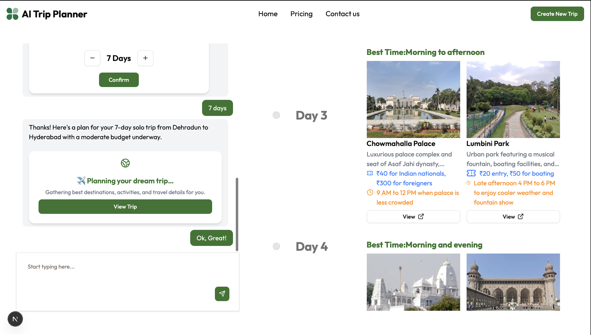

<div align="center">

# ✈️ TripGenie — AI-Powered Trip Planner

**Describe your trip in a chat. Get a complete, day-wise itinerary and hotel recommendations in seconds.**


</div>

---

## 📖 Overview

TripGenie is a full-stack trip-planning application that turns a short conversation into a personalized travel plan. Users enter their destination, trip duration, budget, and group size in an AI chat interface. The app orchestrates calls to an LLM through Next.js API routes and returns a structured, easy-to-read itinerary along with hotel recommendations.

LLM responses are generated in **JSON mode** from structured prompt templates, so the output can be parsed reliably into renderable itinerary data instead of free-form text. API routes are protected with **Arcjet** rate limiting and abuse protection.

## ✨ Features

- **AI chat-based trip input**: provide destination, duration, budget, and group size conversationally.
- **Personalized itineraries**: plans are generated from user preferences and budget constraints.
- **Structured LLM output**: structured prompt templates with JSON-mode responses, parsed into typed itinerary data.
- **Hotel recommendations**: AI-suggested hotels with pricing, ratings, and real images fetched via the Google Places API.
- **Day-wise timeline**: activities, timings, and ticket details laid out for each day of the trip.
- **User authentication**: secure login before accessing trip-planning features.
- **API protection**: rate limiting and abuse protection with Arcjet.
- **Backend data management**: powered by Convex.

## 🛠️ Tech Stack

| Layer | Technology | Purpose |
|---|---|---|
| Framework | **Next.js** | Full-stack framework; API routes orchestrate LLM calls |
| Language | **TypeScript** | Type-safe frontend and backend code |
| AI | **OpenAI API** | Itinerary generation with structured JSON-mode responses |
| Backend & Data | **Convex** | Backend data management |
| Security | **Arcjet** | API rate limiting and abuse protection |
| Places Data | **Google Places API** | Real hotel images |

## 🧭 How It Works



## 📸 Application Screenshots

### 🔐 User Authentication
Secure login system for users before accessing trip planning features.



---

### 🏠 Landing Page
Clean and minimal landing page introducing the AI Trip Planner.



---

### 💬 Trip Input via AI Chat
Users enter trip details such as destination, duration, budget, and group size.



---

### 🏨 AI-Generated Hotel Recommendations
Hotels suggested by AI with pricing, ratings, and real images fetched via Google Places API.



---

### 🗓️ Day-wise Trip Itinerary
Timeline-based UI showing activities, timings, and ticket details.





## 🚀 Getting Started

### Prerequisites

- Node.js 20 or later
- An [OpenAI API key](https://platform.openai.com/api-keys)
- A [Convex](https://www.convex.dev/) account
- An [Arcjet](https://arcjet.com/) account and key
- A [Google Places API](https://developers.google.com/maps/documentation/places/web-service/overview) key

### Installation

```bash
# 1. Clone the repository
git clone https://github.com/amanbansal1506/TripGenie.git
cd TripGenie

# 2. Install dependencies
npm install
```

### Environment Variables

Create a `.env.local` file in the project root:

```env
# OpenAI
OPENAI_API_KEY=your_openai_api_key

# Convex
NEXT_PUBLIC_CONVEX_URL=your_convex_deployment_url
CONVEX_DEPLOYMENT=your_convex_deployment_name

# Arcjet
ARCJET_KEY=your_arcjet_key

# Google Places API
GOOGLE_PLACES_API_KEY=your_google_places_api_key
```

### Run Locally

```bash
# Terminal 1: start the Convex backend
npx convex dev

# Terminal 2: start the Next.js app
npm run dev
```

Open [http://localhost:3000](http://localhost:3000) in your browser.

## 👤 Author

**Aman Bansal**

[](https://github.com/amanbansal1506)
[](https://www.linkedin.com/in/aman-bansal-464b6a270/)
